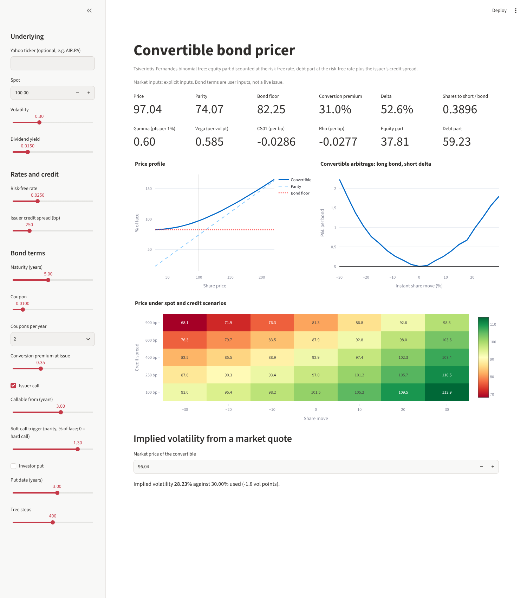
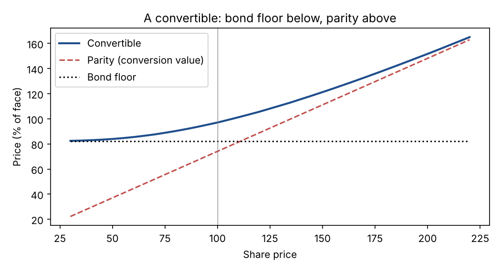
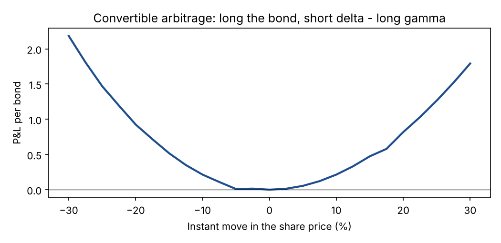
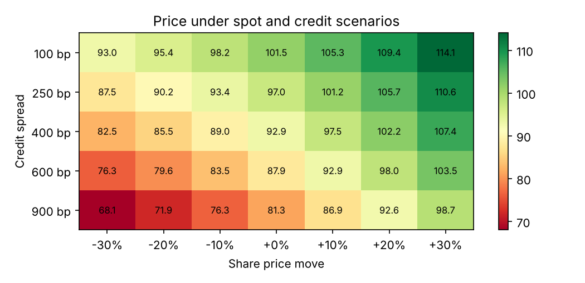

# Convertible bond pricer

A convertible bond priced the way a convertibles desk reads it: price against parity and
bond floor, premiums, Greeks, credit sensitivity, the value of each clause, implied
volatility, scenarios, and the P&L of a delta-hedged position. Python engine, Streamlit +
Plotly dashboard, a **prospectus reader (RAG)** that extracts the bond's terms and feeds
them to the pricer, and a pytest suite.



## The model

A convertible is a bond plus the holder's right to swap it for shares. The two pieces carry
different risk: cash the issuer must repay is exposed to its credit, shares delivered on
conversion are not. The **Tsiveriotis-Fernandes** binomial tree (1998) splits the value at
every node into

- an **equity part**, discounted at the risk-free rate, and
- a **debt part**, discounted at the risk-free rate plus the issuer's credit spread.

At each node, working back from maturity:

1. continuation value = discounted equity part + discounted debt part (+ coupon on coupon dates)
2. **issuer call** (from the call date; soft call only if parity ≥ trigger × face): the
   issuer calls when holding is worth more than the call price, and the holder then converts
   if parity exceeds it
3. **investor put** on its date if the continuation value is below the put price
4. **voluntary conversion** if parity exceeds the value

Prices average a tree of N and N+1 steps to damp the odd/even oscillation. Delta and gamma
are read off the tree's first nodes; vega, rho and CS01 use central bumps.

## Prospectus reader: from terms and conditions to a price (RAG)

Before pricing a new issue, a trader reads its terms and conditions. `prospectus_rag.py`
does that step:

| Step | Method |
|---|---|
| Load and chunk | PDF (pypdf), Markdown or text; overlapping 70-word passages tagged with their page |
| Embed | `sentence-transformers` (multilingual MiniLM, French or English) when installed; otherwise TF-IDF + truncated SVD (LSA) embeddings, fully offline |
| Retrieve | cosine similarity between the question and every passage; neighbouring passages added so a clause cut at a window edge is read whole |
| Answer | with `ANTHROPIC_API_KEY` set, an LLM answers **only from the retrieved passages** and cites them; without a key, the best passage is returned |
| Extract | one retrieval per term (issue and maturity dates, coupon and frequency, conversion price, soft-call date and trigger, put date), then the LLM (JSON) or regular expressions read the value; each term keeps its source passage |
| Price | the terms map to `cb_pricer.Convertible` in years from the valuation date |

```bash
python prospectus_rag.py docs/sample_terms_illustrative.md --spot 40 --ask "Is there dividend protection?"
```

On the sample document every term is extracted correctly (issue 15 Jan 2026, maturity
15 Jan 2031, 1.25% semi-annual, conversion price 54.00, soft call from 5 Feb 2029 at 130%,
put 15 Jan 2029), and the pricer returns 100.34 at a spot of 40 (parity 74.07, bond floor
83.34, delta 47%).

> `docs/sample_terms_illustrative.md` is a **fictional** issuer written to test the tool, not
> a real security. Drop real terms and conditions (PDF) into `docs/` to use it on a live
> issue. The dashboard has the same reader in its "Read the bond terms from a prospectus"
> panel.

## Run

```bash
pip install -r requirements.txt
python run.py                    # report + charts on explicit inputs
python run.py --ticker AIR.PA    # spot and 1-year realised vol of a real share (Yahoo Finance)
streamlit run app.py             # interactive dashboard
pytest -q                        # 15 checks
```

## Results on the illustrative convertible

Explicit inputs, not a live issue: 5 years, 1% semi-annual coupon, conversion premium 35%,
soft call from year 3 at par with a 130% parity trigger; spot 100, vol 30%, rate 2.5%,
dividend 1.5%, credit spread 250 bp. Full output in [out_summary.md](out_summary.md).

| Measure | Value |
|---|---|
| Price | 97.09 |
| Parity / bond floor | 74.07 / 82.25 |
| Conversion premium / premium over floor | 31.1% / 18.1% |
| Delta (share of parity) / shares to short per bond | 52.6% / 0.390 |
| Gamma | 0.60 delta points per 1% move |
| Vega / CS01 | +0.58 per vol point / −0.028 per bp |
| Soft call worth to the issuer | 0.17 points |
| Hard call from year 3 instead | −2.97 points |
| Investor put at year 3 | +2.49 points |

What it shows:

- **Balanced convertible.** Delta near 50% and a 31% premium: the bond sits between its floor
  and parity, where the convexity is.
- **Credit matters as much as equity.** From 250 to 600 bp of spread the price loses about
  9 points at unchanged spot (scenario grid).
- **Convertible arbitrage is long gamma.** Long the bond and short 0.39 shares, the position
  gains on a large move in either direction.
- **Clauses have a price.** A hard call costs the holder about 3 points; a put adds 2.5.





## Controls (tests/)

- No coupon, call, dividend or spread: price = zero-coupon + ratio × Black-Scholes call
  (within 0.03).
- Price ≥ parity and ≥ bond floor when there is no call.
- Deep in the money: premium < 1% and delta > 97%; deep out of the money: price = bond floor.
- A call lowers the price, a hard call more than a soft one, a put raises it.
- Equity part + debt part = price; implied volatility round trip.
- The delta-hedged position gains on ±20% moves.
- Prospectus reader: overlapping chunks, retrieval finds the right clause, all eight terms
  extracted, terms feed the pricer, extractive answers cite three passages, and the LLM JSON
  path is parsed correctly (tested with a mocked reply).

## Limits

- One-factor model: constant volatility, deterministic rates and credit spread.
- Soft call checked on the node's parity, not on the 20-out-of-30-day rule of a real
  prospectus.
- No accrued interest on conversion or call, no make-whole, no dividend protection, no
  default jump to the share price.
- Bond terms are illustrative; only spot and volatility can come from the market.
- The regular-expression extractor is written for English and French terms and conditions in
  the usual format; unusual wording needs the LLM path. The LSA embeddings are fitted on one
  document at a time and are weaker than sentence-transformers.
